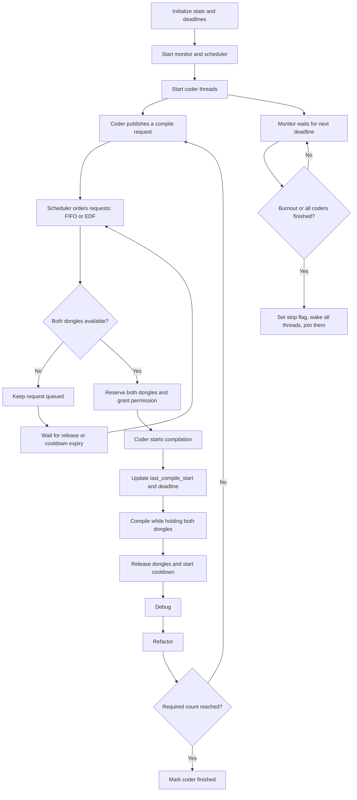

*This project has been created as part of the 42 curriculum by tokinira.*

# Codexion

Codexion is a C simulation of coders competing for shared dongles. Each coder
runs in its own POSIX thread and repeats this cycle:

```text
request two dongles -> compile -> release dongles -> debug -> refactor
```

The simulation uses mutexes, condition variables, a dedicated scheduler and a
monitor thread. The scheduler supports two policies:

- `fifo`: process requests in arrival order;
- `edf`: process the request with the earliest burnout deadline first.

<p align="center">
  
</p>

## Requirements

- Linux or another POSIX-compatible system;
- `cc` or `gcc`;
- `make`;
- POSIX threads (`pthread`).

## Build

The default target builds the normal executable:

```sh
make
```

| Command | Purpose |
| --- | --- |
| `make all` | Build `codexion` |
| `make re` | Clean and rebuild the normal executable |
| `make tsan` | Build `codexion_tsan` with ThreadSanitizer |
| `make retsan` | Clean and rebuild the ThreadSanitizer executable |
| `make asan` | Build `codexion_asan` with AddressSanitizer |
| `make clean` | Remove normal object files |
| `make fclean` | Remove object files and executables |

Normal compilation uses:

```text
-Wall -Wextra -Werror -pthread
```

## Usage

```sh
./codexion number_of_coders time_to_burnout time_to_compile \
    time_to_debug time_to_refactor number_of_compiles_required \
    dongle_cooldown scheduler
```

All numeric arguments must contain decimal digits and fit in an `int`.
`number_of_coders`, `time_to_burnout` and `number_of_compiles_required` must
be at least `1`; `time_to_compile`, `time_to_debug`, `time_to_refactor` and
`dongle_cooldown` may be `0`. The scheduler must be `fifo` or `edf`.

| Argument | Meaning |
| --- | --- |
| `number_of_coders` | Number of coder threads and dongles |
| `time_to_burnout` | Maximum time since the last compilation start |
| `time_to_compile` | Compilation duration |
| `time_to_debug` | Debugging duration |
| `time_to_refactor` | Refactoring duration |
| `number_of_compiles_required` | Compilations required by each coder |
| `dongle_cooldown` | Time before a released dongle becomes available again |
| `scheduler` | `fifo` or `edf` |

Example:

```sh
./codexion 5 800 200 200 200 3 200 fifo
./codexion 4 900 200 200 100 5 100 edf
```

Each log line has this format:

```text
<elapsed milliseconds> <coder id> <event>
```

Possible events include `has taken a dongle`, `is compiling`, `is debugging`,
`is refactoring` and `burned out`.

## How the simulation runs

The simulation starts one monitor thread, one scheduler thread and one coder
thread per coder. Each coder repeatedly follows this cycle:

```text
publish request -> wait for permission -> take two dongles -> compile
-> release dongles -> debug -> refactor
```



### Compile deadlines

The monitor and coders share the deadline state through `state_mutex`:

```text
first compilation deadline = simulation_start_time + time_to_burnout
next compilation deadline  = last_compile_start + time_to_burnout
```

`last_compile_start` is updated at the beginning of the effective compilation,
not when the request is created, permission is granted or dongles are
reserved. A coder burns out when `current_time >= deadline` and its next
compilation has not started. The equality case is therefore inclusive.

The scheduler and monitor use condition variables rather than busy polling.
Several coders can compile simultaneously when their dongle pairs do not
overlap. A coder with one dongle cannot compile; the single-coder case exits
through the monitor's burnout path without blocking indefinitely.

## Architecture

| File or directory | Responsibility |
| --- | --- |
| `main.c` | Entry point and simulation startup |
| `parsing.c` | Numeric, range and scheduler validation |
| `init.c`, `cleanup.c` | Resource initialization and destruction |
| `init_sync.c` | Mutex, condition variable and queue initialization |
| `simulation.c` | Worker thread creation and joining |
| `coder.c` | Coder thread lifecycle |
| `coder_acquire.c` | Request waiting and dongle acquisition |
| `coder_cycle.c` | Compile, debug, refactor and completion count |
| `dongle.c` | Reservation, release and cooldown handling |
| `scheduler.c` | Scheduler thread and retry timing |
| `scheduler_dispatch.c` | Request selection and permission granting |
| `monitor.c`, `termination.c` | Burnout, completion and shutdown |
| `logging.c` | Serialized terminal output |
| `states.c` | Shared state and compile requests |
| `queue/` | Binary heap implementation and ordering |
| `includes/codexion.h` | Shared structures and declarations |

## Verification

Build the sanitizer variants and run representative scenarios:

```sh
make tsan
TSAN_OPTIONS="halt_on_error=0" ./codexion_tsan 4 3000 50 20 20 2 20 edf

make asan
./codexion_asan 4 3000 50 20 20 2 20 edf
```

Test both scheduling policies with one coder, several coders, short burnout
limits and non-zero dongle cooldowns. Thread sanitizer results can vary
between runs because the simulation is concurrent.

## Project structure

```text
codexion/
├── Makefile
├── README.md
├── assets/
│   └── Codexion_ Dining Philosophers.png
├── includes/
│   └── codexion.h
└── srcs/
    ├── main.c
    ├── parsing.c
    ├── states.c
    ├── simulation.c
    ├── time.c
    ├── init.c
    ├── init_sync.c
    ├── cleanup.c
    ├── coder.c
    ├── coder_acquire.c
    ├── coder_cycle.c
    ├── dongle.c
    ├── scheduler.c
    ├── scheduler_dispatch.c
    ├── monitor.c
    ├── logging.c
    ├── termination.c
    └── queue/
        ├── priority_queue.c
        └── priority_queue_heap.c
```

## Resources

  ### GeeksforGeeks

  * [Mutex lock for Linux thread synchronization](https://www.geeksforgeeks.org/mutex-lock-for-linux-thread-synchronization/): mutex, lock/unlock in C.
  * [Condition variables: wait and signal](https://www.geeksforgeeks.org/condition-wait-signal-multi-threading/): `pthread_cond_wait` / `pthread_cond_signal`.
  * [Dining philosophers problem](https://www.geeksforgeeks.org/dining-philosophers-problem/): original problem and solutions.
  * [Binary heap](https://www.geeksforgeeks.org/binary-heap/): data structure behind the priority queue.

  ### Wikipedia

  * [Deadlock](<https://en.wikipedia.org/wiki/Deadlock_(computer_science)>): the four Coffman conditions.
  * [Earliest deadline first scheduling](https://en.wikipedia.org/wiki/Earliest_deadline_first_scheduling): basis of the EDF policy.

  ### Man pages

  * [`pthread_mutex_lock(3p)`](https://man7.org/linux/man-pages/man3/pthread_mutex_lock.3p.html): lock, unlock, trylock.
  * [`pthread_cond_timedwait(3p)`](https://man7.org/linux/man-pages/man3/pthread_cond_timedwait.3p.html): timed wait used by the scheduler.
  * [`clock_gettime(2)`](https://man7.org/linux/man-pages/man2/clock_gettime.2.html): timestamps et délais absolus en millisecondes (CLOCK_REALTIME).

  ### YouTube

  * CodeVault, *Unix Threads in C* (playlist): threads, mutexes, condition variables.
  * Jacob Sorber, *Introduction To Threads (pthreads) | C Programming Tutorial*: pthread basics.

  ### AI usage

  * **ChatGPT**: explanations of concurrency concepts, algorithm design suggestions, README review and generation of `assets/Codexion_ Dining Philosophers.png`.
  * **Perplexity**: comparison of AddressSanitizer and ThreadSanitizer.
  * **Claude Code**: debugging, optimization and README rewording.