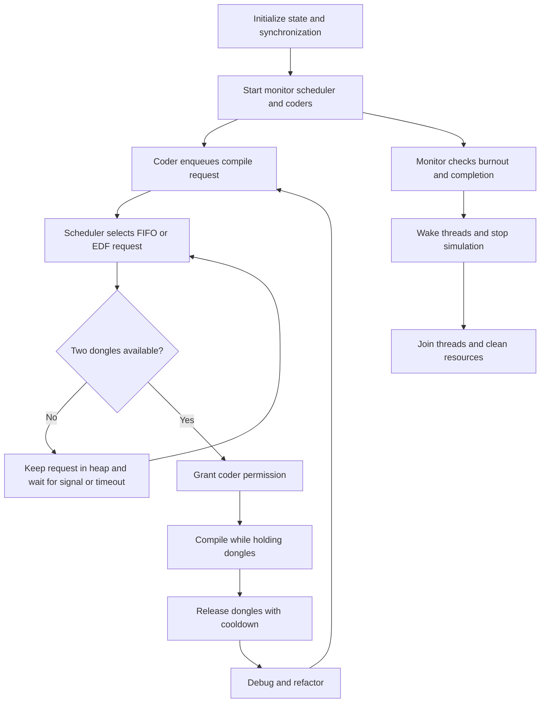

*This project was created as part of the 42 curriculum by tokinira.*

# Codexion

Codexion is a C simulation of coders competing for shared dongles. Each coder
runs in its own POSIX thread and repeats this cycle:

```text
request two dongles -> compile -> release dongles -> debug -> refactor
```

The simulation uses mutexes, condition variables, a dedicated scheduler and a
monitor thread. The scheduler supports two policies:

- `fifo`: process requests in arrival order;
- `edf`: process the request with the earliest burnout deadline first.

<p align="center">
  
</p>

## Requirements

- Linux or another POSIX-compatible system;
- `cc` or `gcc`;
- `make`;
- POSIX threads (`pthread`).

## Build

The default target builds the normal executable:

```sh
make
```

| Command | Purpose |
| --- | --- |
| `make all` | Build `codexion` |
| `make re` | Clean and rebuild the normal executable |
| `make tsan` | Build `codexion_tsan` with ThreadSanitizer |
| `make retsan` | Clean and rebuild the ThreadSanitizer executable |
| `make asan` | Build `codexion_asan` with AddressSanitizer |
| `make clean` | Remove normal object files |
| `make fclean` | Remove object files and executables |

Normal compilation uses:

```text
-Wall -Wextra -Werror -pthread
```

## Usage

```sh
./codexion number_of_coders time_to_burnout time_to_compile \
    time_to_debug time_to_refactor number_of_compiles_required \
    dongle_cooldown scheduler
```

All numeric arguments must contain decimal digits and fit in an `int`. The
number of coders must be at least `1`. The scheduler must be `fifo` or `edf`.
Zero is accepted by the parser for duration and count parameters.

| Argument | Meaning |
| --- | --- |
| `number_of_coders` | Number of coder threads and dongles |
| `time_to_burnout` | Maximum time since the last compilation start |
| `time_to_compile` | Compilation duration |
| `time_to_debug` | Debugging duration |
| `time_to_refactor` | Refactoring duration |
| `number_of_compiles_required` | Compilations required by each coder |
| `dongle_cooldown` | Time before a released dongle becomes available again |
| `scheduler` | `fifo` or `edf` |

Example:

```sh
./codexion 5 800 200 200 200 3 200 fifo
./codexion 4 900 200 200 100 5 100 edf
```

Each log line has this format:

```text
<elapsed milliseconds> <coder id> <event>
```

Possible events include `has taken a dongle`, `is compiling`, `is debugging`,
`is refactoring` and `burned out`.

## Scheduling model

Each coder requests its two neighbouring dongles. The scheduler keeps pending
requests in a custom binary heap and only grants permission after reserving
both dongles.

Dongles are considered in a consistent order. Reservation uses
`pthread_mutex_trylock`; if the second dongle cannot be reserved, the first
reservation is rolled back. This avoids circular wait and lets independent
coders compile concurrently.

After compilation, both dongles are released with an `available_at` timestamp.
The scheduler waits on its condition variable and, when necessary, sleeps
until the next dongle cooldown expires. New requests, dongle releases and
termination wake it earlier.

For EDF, a request deadline is calculated from the coder's last compilation
start:

```text
deadline = last_compile_start + time_to_burnout
```

Arrival order is used as the tie-breaker when two EDF deadlines are equal.



## Termination

The monitor checks the shared state every 500 microseconds. It stops the
simulation when:

- a coder reaches its burnout limit since the last compilation start; or
- every coder has completed the required number of compilations.

Termination sets the shared stop flag and wakes coder and scheduler condition
variables. The main thread then joins the worker threads and destroys the
allocated resources and synchronization primitives.

With one coder, only one dongle exists, so a compilation requiring two dongles
cannot start. The coder waits until the monitor stops the simulation.

## Architecture

| File or directory | Responsibility |
| --- | --- |
| `main.c` | Entry point and simulation startup |
| `parsing.c` | Numeric and scheduler validation |
| `init.c`, `cleanup.c` | Resource initialization and destruction |
| `simulation.c` | Worker thread creation and joining |
| `coder.c` | Coder thread lifecycle |
| `coder_acquire.c` | Request waiting and dongle acquisition |
| `coder_cycle.c` | Compile, debug, refactor and completion count |
| `dongle.c` | Reservation, release and cooldown handling |
| `scheduler.c` | Scheduler thread and retry timing |
| `scheduler_dispatch.c` | Request selection and permission granting |
| `monitor.c`, `termination.c` | Burnout, completion and shutdown |
| `logging.c` | Serialized terminal output |
| `states.c` | Shared state and compile requests |
| `queue/` | Binary heap implementation and ordering |
| `includes/codexion.h` | Shared structures and declarations |

## Verification

Build the sanitizer variants and run representative scenarios:

```sh
make tsan
TSAN_OPTIONS="halt_on_error=0" ./codexion_tsan 4 3000 50 20 20 2 20 edf

make asan
./codexion_asan 4 3000 50 20 20 2 20 edf
```

Test both scheduling policies with one coder, several coders, short burnout
limits and non-zero dongle cooldowns. Thread sanitizer results can vary
between runs because the simulation is concurrent.

## Project structure

```text
coders/
├── Makefile
├── README.md
├── assets/
│   └── Codexion_ Dining Philosophers.png
├── includes/
│   └── codexion.h
└── srcs/
    ├── main.c
    ├── parsing.c
    ├── states.c
    ├── simulation.c
    ├── time.c
    ├── init.c
    ├── cleanup.c
    ├── coder.c
    ├── coder_acquire.c
    ├── coder_cycle.c
    ├── dongle.c
    ├── scheduler.c
    ├── scheduler_dispatch.c
    ├── monitor.c
    ├── logging.c
    ├── termination.c
    └── queue/
        ├── priority_queue.c
        └── priority_queue_heap.c
```